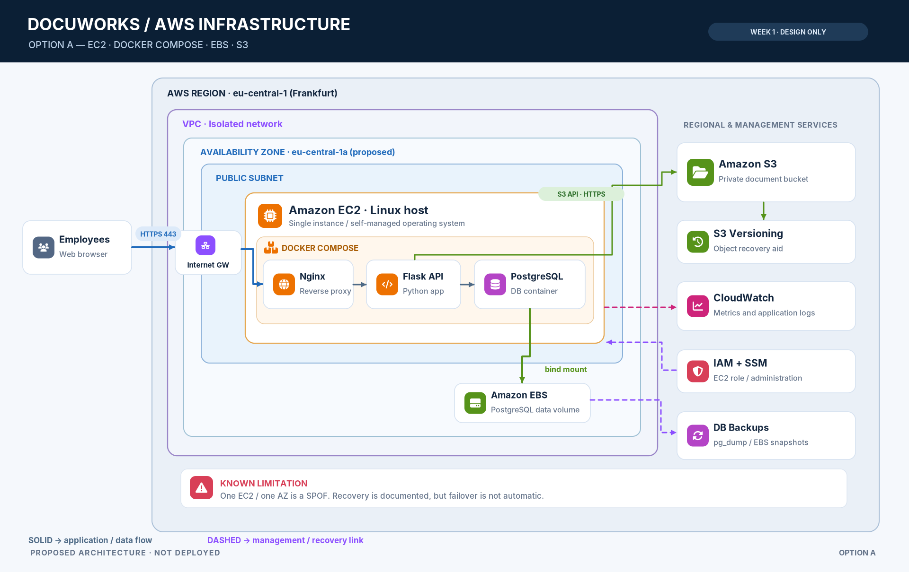

Architecture Option A — EC2-Based Containerized Solution

Project: AWS Infrastructure for a Document Management Platform
Company: DocuWorks GmbH
Phase: Week 1 — Architecture Design
Status: Proposed Architecture — Not Yet Implemented

1. Overview

Architecture Option A proposes a simple and cost-conscious AWS infrastructure for the document management platform of DocuWorks GmbH.

The solution uses Amazon EC2 to host a Linux-based application environment.

Docker and Docker Compose will be used to run the application and PostgreSQL database in separate containers.

Persistent database files will be stored on an Amazon EBS volume, while uploaded customer documents will be stored in Amazon S3.

Terraform will be used to provision the AWS infrastructure.

The main goal is to separate application runtime, persistent application data, and document storage while keeping the architecture manageable for a small company.

⸻

2. Architecture Components

Component	Technology	Purpose
Cloud Platform	AWS	Infrastructure hosting
Region	eu-central-1 (Frankfurt)	Proposed deployment region
Network	Amazon VPC	Isolated virtual network
Subnet	Public Subnet	Hosting the initial EC2 instance
Internet Access	Internet Gateway	Network connectivity
Compute	Amazon EC2	Linux application server
Containerization	Docker	Application and database containers
Container Management	Docker Compose	Container configuration and startup
Web Application	Python / Flask (proposed)	Document management interface
Database	PostgreSQL	Structured application data
Persistent Storage	Amazon EBS	PostgreSQL database files
Document Storage	Amazon S3	Uploaded documents
Access Control	AWS IAM	AWS resource permissions
Network Security	Security Groups	Network traffic restrictions
Monitoring	Amazon CloudWatch	Basic monitoring and logging
Database Backup	PostgreSQL backup / EBS snapshots	Recovery of database data
Document Protection	S3 Versioning	Recovery of previous document versions
Infrastructure as Code	Terraform	Automated infrastructure provisioning

The exact EC2 instance type, operating system version, and storage sizes will be determined during implementation.

⸻

3. High-Level Architecture

The proposed architecture contains the following main components:

1. Employees access the document management application through a web browser.
2. Incoming requests reach a controlled HTTPS endpoint on the EC2 instance.
3. A reverse proxy forwards application requests to the Python application container.
4. The application container communicates with the PostgreSQL container through an internal Docker network.
5. PostgreSQL stores its database files on a separate EBS volume.
6. The application accesses Amazon S3 through the AWS SDK to upload and retrieve documents.
7. An IAM Instance Role provides permissions for required AWS API operations.
8. CloudWatch provides basic infrastructure monitoring and logging.
9. Database backups and S3 data protection support recovery.

The architecture uses one EC2 instance and one Availability Zone for the initial implementation.

This is a deliberate simplification and does not provide automatic high availability.
## Architecture Diagram

⸻

4. Network Architecture

4.1 Amazon VPC

A dedicated Amazon VPC will contain the EC2 infrastructure.

The initial design includes:

* One VPC.
* One public subnet.
* An Internet Gateway.
* A route table.
* A Security Group for the EC2 instance.

The EC2 instance will have the network connectivity required to serve application requests and access AWS APIs.

4.2 Public Application Access

The proposed production-like access method is HTTPS.

A reverse proxy such as Nginx will handle incoming web requests and forward them to the application container.

HTTPS requires a suitable domain name and valid TLS certificate.

For a temporary demonstration without a domain, an alternative restricted access method may be evaluated.

Real customer documents must not be used in an unsecured demonstration environment.

4.3 Database Network Access

The PostgreSQL database will run in a separate Docker container.

The application and database containers will communicate using an internal Docker Compose network.

PostgreSQL will use its internal TCP port 5432.

The PostgreSQL port will not be published publicly on the EC2 instance.

Only the application components that require database access should be able to connect to PostgreSQL.

4.4 Security Groups

The EC2 Security Group will allow only required traffic.

Proposed rules:

Direction	Protocol / Port	Purpose
Inbound	TCP 443	HTTPS application access
Inbound	TCP 80	Optional HTTP-to-HTTPS redirect
Inbound	TCP 22	Not required when using Session Manager
Inbound	TCP 5432	Not allowed from the internet
Outbound	Required connections	AWS APIs, software installation, and updates

Application-level authentication will provide an additional layer of protection.

Administrative access using AWS Systems Manager Session Manager will be considered to avoid exposing SSH to the internet.

⸻

5. EC2 Application Environment

Amazon EC2 will host the Linux operating system and Docker runtime.

The EC2 instance will be responsible for:

* Running Docker Engine.
* Running Docker Compose.
* Hosting the application containers.
* Connecting to the EBS database volume.
* Accessing Amazon S3.
* Providing application logs and metrics.

The EC2 instance will have a root volume for the operating system and a separate data volume for PostgreSQL.

5.1 Docker Containers

Docker Compose will define the application services.

Application Container

The application container will contain the Python web application and its required dependencies.

The application will handle:

* Document upload.
* Document retrieval.
* Document metadata.
* Document search.
* Document processing status.

PostgreSQL Container

The PostgreSQL container will store structured application data.

The database files will be located on a persistent EBS-backed host directory.

Reverse Proxy

A reverse proxy will provide the public web entry point and forward requests to the application container.

The final container structure will be implemented and tested during the application deployment phase.

⸻

6. Persistent Database Storage

6.1 Amazon EBS

A separate Amazon EBS volume will provide persistent storage for PostgreSQL.

The EBS volume will be attached to the EC2 instance, formatted, and mounted on the Linux host.

A proposed host directory is:

/srv/docuworks/postgres-data

Docker Compose will use a bind mount to provide this directory to the PostgreSQL container.

This separates database persistence from the temporary container filesystem.

6.2 PostgreSQL Data

PostgreSQL will store structured data such as:

* Document identifiers.
* Document names.
* Upload timestamps.
* Processing status.
* Processing results.
* S3 object references.

The actual PDF or image files will not be stored directly in PostgreSQL.

6.3 Data Persistence

Restarting or replacing the application container must not remove the persistent database files.

The EBS data volume must also be protected against unintended deletion.

If the EC2 instance is replaced, the existing EBS volume may be attached to another compatible EC2 instance in the same Availability Zone, provided the volume was preserved and detached safely.

Alternatively, a replacement EBS volume may be restored from a suitable snapshot.

The PostgreSQL environment must be recovered correctly before the application resumes database operations.

6.4 Limitations

Amazon EBS is associated with a specific Availability Zone.

A single EBS volume does not provide automatic database failover.

Database corruption or accidental data deletion may require restoration from backup.

⸻

7. Document Storage — Amazon S3

Amazon S3 will provide object storage for uploaded customer documents.

Documents will be stored separately from the EC2 instance and Docker containers.

Examples:

* PDF documents.
* Images.
* Uploaded customer files.
* Generated document processing outputs.

7.1 Document Upload

When an employee uploads a document:

1. The application receives the file.
2. The application validates the request and document.
3. The application uploads the file to Amazon S3 using the AWS SDK.
4. The application stores the S3 object key and document metadata in PostgreSQL.
5. The application returns a success response.

7.2 Document Retrieval

When an employee requests a document:

1. The application authenticates and authorizes the employee.
2. The application searches PostgreSQL for the document metadata.
3. The application retrieves the corresponding S3 object key.
4. The application accesses the object in S3.
5. The authorized employee receives the document.

7.3 S3 Security

The S3 bucket will use:

* Block Public Access.
* Appropriate encryption settings.
* Least-privilege IAM access.
* S3 Versioning where appropriate.
* Restricted access to customer documents.

The application will access S3 using the EC2 Instance Role.

Long-lived AWS access keys will not be stored in application source code.

⸻

8. Application and Database Communication

The application and PostgreSQL containers will communicate over a private Docker network.

The application will use an internal database hostname defined by Docker Compose.

For example, the PostgreSQL service may be named db.

The application can then connect to the database using the hostname db and port 5432.

Database credentials will be provided through a secure configuration mechanism.

Credentials must not be committed to GitHub.

The selected credentials management approach will be finalized during implementation.

⸻

9. Security Design

The architecture will implement basic security controls appropriate for a small company.

9.1 AWS IAM

An EC2 Instance Role will provide the permissions required to access AWS services.

The role should be limited to the specific S3 operations and other AWS API actions required by the application.

9.2 Network Security

Security Groups will restrict network access.

PostgreSQL will not be directly accessible from the internet.

Only the reverse proxy will expose the required application endpoint.

9.3 Data Protection

The design will consider:

* Encryption of the EBS volume.
* S3 encryption.
* HTTPS for application traffic.
* Secure database credentials.
* Private document access.
* Application authentication and authorization.

9.4 Secrets Management

Application and database credentials must not be stored in the GitHub repository.

Sensitive values must be excluded from public source code and protected Terraform state.

⸻

10. Backup and Recovery

10.1 PostgreSQL Backup

Database-aware PostgreSQL backups are proposed as the primary logical backup mechanism.

Backups may be uploaded to a separate protected S3 backup location.

EBS snapshots may provide an additional recovery mechanism.

Snapshot procedures must account for PostgreSQL consistency.

The final backup schedule and retention policy will be defined during implementation.

10.2 Document Recovery

Amazon S3 Versioning is proposed to protect against accidental overwriting and certain deletion scenarios.

Versioning is not a complete independent backup solution.

Additional retention and recovery policies may be required.

10.3 EC2 Failure Recovery

If the EC2 instance fails:

1. Identify the infrastructure failure.
2. Create or provision a replacement EC2 instance using Terraform.
3. Restore or reattach persistent database storage.
4. Mount the database volume.
5. Start Docker and Docker Compose.
6. Verify PostgreSQL availability.
7. Start the application.
8. Verify connectivity to Amazon S3.
9. Test document retrieval and application data availability.

The proposed architecture does not provide automatic failover.

Recovery time depends on the failure scenario and the restoration process.

⸻

11. Monitoring and Logging

Amazon CloudWatch will provide basic infrastructure monitoring.

Monitoring will focus on:

* EC2 instance health.
* CPU utilization.
* Infrastructure status.
* Application logs.
* Container failures.
* Database-related errors.

Additional monitoring configuration may be required for memory usage, disk usage, and container-level metrics.

Basic alarms may be configured to detect critical infrastructure issues.

Detailed monitoring will be implemented in a later project phase.

⸻

12. Infrastructure as Code

Terraform will manage the AWS infrastructure.

Planned resources include:

* AWS VPC.
* Public subnet.
* Internet Gateway.
* Route table and associations.
* Security Group.
* EC2 instance.
* EBS data volume and attachment.
* S3 document bucket.
* IAM Instance Role and policies.
* Monitoring resources where required.

Terraform will provision infrastructure.

Docker Compose will configure and run application services on the EC2 instance.

Bootstrap configuration may be used to install Docker and prepare the host environment.

The final infrastructure must be reproducible.

Terraform state and sensitive configuration must not be committed to GitHub.

⸻

13. Cost Considerations

Architecture A is designed to minimize unnecessary AWS resources.

The major cost components are:

* EC2 compute.
* EBS storage.
* EBS snapshots.
* S3 storage and requests.
* Public IPv4 usage.
* Monitoring.
* Data transfer.

The initial implementation does not require:

* Amazon RDS.
* Amazon ECS Fargate.
* Application Load Balancer.
* NAT Gateway.

This can reduce cost and operational complexity.

However, the actual cost depends on the selected instance type, storage capacity, network usage, and deployment duration.

The resource configuration and expected cost will be evaluated during Week 2.

⸻

14. Advantages

The main advantages of Architecture A are:

1. Relatively simple infrastructure.
2. Potentially lower initial cost.
3. Direct control over the Linux environment.
4. Docker-based application deployment.
5. Persistent PostgreSQL storage on EBS.
6. Separate document storage in S3.
7. Infrastructure reproducibility using Terraform.
8. Suitable for a small team and moderate workload.

⸻

15. Disadvantages and Limitations

The architecture has several limitations:

1. A single EC2 instance remains a Single Point of Failure.
2. PostgreSQL database administration is self-managed.
3. Application and database containers compete for the same EC2 CPU and memory resources.
4. Scaling requires additional infrastructure design.
5. EBS is associated with one Availability Zone.
6. Database recovery may require manual operations.
7. The architecture does not provide automatic failover.
8. Containerization alone does not guarantee availability or data persistence.

These limitations are acceptable for evaluation as a simple initial architecture but must be considered before production deployment.

⸻

16. Requirements Mapping

Requirement	Proposed Solution
Application hosting	Amazon EC2
Containerized application	Docker and Docker Compose
Persistent application data	PostgreSQL on EBS
Separate document storage	Amazon S3
Secure AWS access	IAM Instance Role
Network restrictions	VPC and Security Groups
Backup and recovery	PostgreSQL backups, EBS snapshots, S3 protection
Monitoring and logging	Amazon CloudWatch
Reproducible infrastructure	Terraform
Cost efficiency	Small EC2-based architecture without unnecessary managed components

⸻

17. Conclusion

Architecture Option A provides a relatively simple and cost-conscious AWS infrastructure for DocuWorks GmbH.

It combines Amazon EC2, Docker Compose, PostgreSQL, Amazon EBS, and Amazon S3.

The central design principle is to separate application execution from persistent database data and uploaded documents.

The proposed design addresses the main requirements for application hosting, storage persistence, security, monitoring, and recovery.

Its primary limitations are the single EC2 instance, self-managed database operations, and lack of automatic failover.

Architecture Option A will be compared with Architecture Option B during Week 2 before the final infrastructure decision is made.