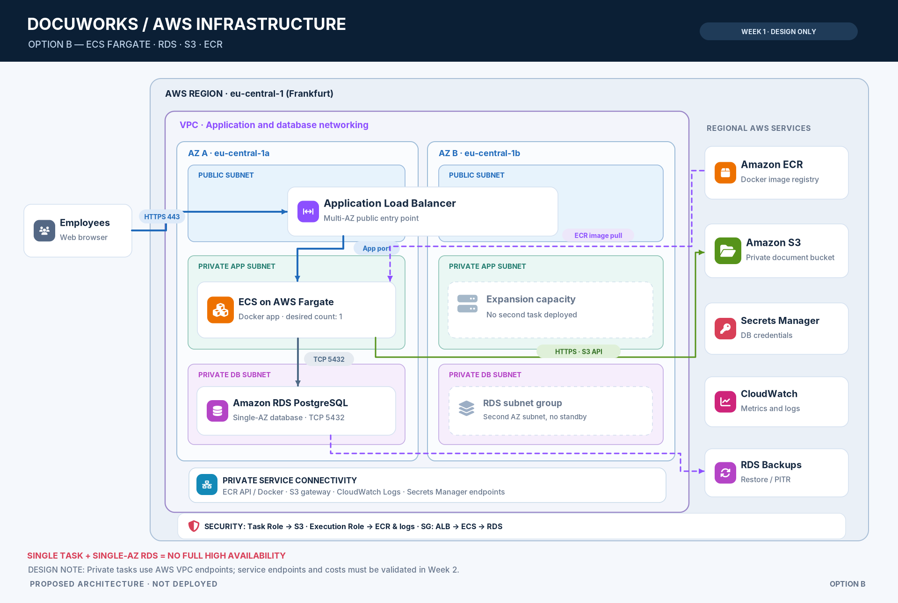

Architecture Option B — ECS Fargate-Based Solution

Project: AWS Infrastructure for a Document Management Platform
Company: DocuWorks GmbH
Phase: Week 1 — Architecture Design
Status: Proposed Architecture — Not Yet Implemented

1. Overview

Architecture Option B proposes a container-based AWS infrastructure using managed cloud services.

The solution uses Amazon ECS with AWS Fargate to run the document management application in a Docker container.

Amazon RDS for PostgreSQL provides persistent application data storage, while Amazon S3 stores uploaded customer documents.

Amazon ECR stores the Docker application image, and an Application Load Balancer provides a controlled entry point for application traffic.

Terraform will be used to provision and manage AWS infrastructure resources.

The main goal is to separate application execution, database management, and document storage while reducing direct server administration.

This architecture is more complex than Architecture Option A and may introduce higher operating costs.

⸻

2. Architecture Components

Component	Technology	Purpose
Cloud Platform	AWS	Infrastructure hosting
Region	eu-central-1 (Frankfurt)	Proposed AWS Region
Networking	Amazon VPC	Isolated virtual network
Public Access	Application Load Balancer	Application entry point
Compute	Amazon ECS with AWS Fargate	Container execution
Containerization	Docker	Application packaging
Image Registry	Amazon ECR	Docker image storage
Web Application	Python / Flask (proposed)	Document management
Database	Amazon RDS PostgreSQL	Persistent application data
Document Storage	Amazon S3	Uploaded customer documents
Access Control	AWS IAM	AWS resource permissions
Network Security	Security Groups	Network traffic restrictions
Secrets	Secrets Manager or SSM Parameter Store	Secure configuration
Monitoring	Amazon CloudWatch	Metrics and application logs
Database Backup	RDS automated backups	Database recovery
Document Protection	S3 Versioning	Object version recovery
Infrastructure as Code	Terraform	Infrastructure provisioning

The final resource sizes and network configuration will be determined during implementation.

⸻

3. High-Level Architecture

The proposed architecture follows this request flow:

1. An employee accesses the application through a web browser.
2. The request reaches an Application Load Balancer.
3. The load balancer forwards the request to a healthy ECS Fargate Task.
4. The Fargate Task runs the Docker application container.
5. The application connects to Amazon RDS PostgreSQL for structured application data.
6. The application accesses Amazon S3 to upload or retrieve document files.
7. Amazon ECR stores the application Docker image.
8. IAM roles provide permissions for AWS API operations.
9. CloudWatch collects metrics and application logs.
10. Backup and recovery mechanisms protect persistent data.

The application container does not store important data in its temporary filesystem.

Application data and documents remain independent of the container lifecycle.

## Architecture Diagram

⸻

4. Network Architecture

4.1 Amazon VPC

The proposed production-oriented network design includes:

* One VPC.
* Two public subnets in different Availability Zones.
* Two private application subnets.
* Two private database subnets.
* An Internet Gateway.
* Route tables.
* Security Groups.
* Required outbound connectivity for private ECS Tasks.

The public subnets will host the Application Load Balancer.

The private application subnets will host ECS Fargate Tasks.

The private database subnets will be used by the RDS DB subnet group.

Although the design includes two Availability Zones, the initial deployment may use only one running application task and a Single-AZ RDS instance to reduce costs.

This does not provide full high availability.

4.2 Application Load Balancer

An internet-facing Application Load Balancer will receive incoming application traffic.

The load balancer will forward requests to ECS Tasks through a target group.

The proposed target type is ip, which is required for Fargate networking.

An application health-check endpoint, such as /health, will be used to check whether the application is responding.

HTTPS will be used when a domain and valid TLS certificate are available.

4.3 Private Application Subnets

ECS Tasks will run in private subnets without directly exposing their application ports to the internet.

Only traffic from the Application Load Balancer Security Group will be allowed to reach the application.

The application must have the required network connectivity to access AWS services.

Possible outbound connectivity solutions include:

* NAT Gateway.
* VPC endpoints for required AWS services.

For a private Fargate deployment without NAT, relevant endpoints may include:

* ECR API interface endpoint.
* ECR Docker interface endpoint.
* S3 Gateway endpoint.
* CloudWatch Logs interface endpoint.
* Secrets Manager endpoint, if required.

These options introduce additional configuration and potentially additional costs.

The exact approach will be evaluated during Week 2.

4.4 Private Database Subnets

Amazon RDS PostgreSQL will run in private database networking.

The database will not be publicly accessible.

The RDS DB subnet group will include subnets in at least two Availability Zones.

The initial RDS deployment may use a Single-AZ database instance.

4.5 Security Group Rules

The proposed network restrictions are:

Component	Allowed Incoming Traffic
ALB	HTTPS 443 from approved clients
ECS Application	Application port from ALB Security Group
RDS PostgreSQL	TCP 5432 from ECS Task Security Group
S3	Access through authorized AWS API requests

Administrative and application access will be restricted according to the security requirements.

⸻

5. Container Architecture

5.1 Docker

Docker will package the Python application and its dependencies into a container image.

The same application image can be used for local testing and AWS deployment, provided the target CPU architecture is compatible.

This helps maintain a consistent runtime environment.

5.2 Amazon ECR

Amazon ECR will store the application’s Docker image.

The image deployment process will include:

1. Build the Docker image.
2. Tag the image for the ECR repository.
3. Authenticate Docker to ECR.
4. Push the image to ECR.
5. Configure the ECS Task Definition to reference the image.

The ECR repository may be provisioned using Terraform.

Docker image building and pushing will be performed through Docker commands or an automated deployment process.

5.3 Amazon ECS

Amazon ECS will manage the container deployment.

The main ECS components include:

ECS Cluster

A logical environment used to manage ECS workloads.

Task Definition

Defines the application container configuration, including:

* Container image.
* CPU and memory.
* Container port.
* Environment configuration.
* IAM roles.
* Logging configuration.
* Container runtime architecture.

ECS Service

Maintains the desired number of running application tasks.

For the initial demonstration, one running task may be sufficient.

A production-ready solution may require multiple tasks distributed across Availability Zones.

5.4 AWS Fargate

AWS Fargate provides compute capacity for ECS Tasks without requiring the project to manage EC2 instances.

The application will run in a Linux container environment.

Persistent database records and documents will be stored outside the Fargate Task.

⸻

6. Persistent Application Data — Amazon RDS

6.1 Amazon RDS PostgreSQL

Amazon RDS for PostgreSQL will store structured application data.

Examples include:

* Document identifiers.
* Document metadata.
* Upload timestamps.
* Processing status.
* Processing results.
* References to S3 objects.

The original company’s database technology is unknown.

PostgreSQL is a proposed technology for the project implementation.

6.2 Database Connection

The application container will connect to RDS using its database endpoint.

The connection will use PostgreSQL over TCP port 5432.

Only the ECS Task Security Group will be authorized to connect to the database.

Database credentials will be supplied through a secure configuration mechanism.

The application will not expose the RDS endpoint or database credentials directly to end users.

6.3 Database Persistence

RDS storage is separate from the application container filesystem.

Restarting or replacing an ECS Task does not delete the RDS database.

The new application task can connect to the existing database using the configured endpoint and credentials.

However, RDS data persistence does not eliminate the need for backups or database recovery planning.

6.4 RDS Configuration

The initial proposed configuration includes:

* PostgreSQL database engine.
* Single-AZ deployment.
* Private network access.
* Storage encryption.
* Automated backups.
* Restricted Security Group.
* Monitoring.

The instance class, allocated storage, backup retention, and database version will be selected during implementation.

6.5 Limitations

Amazon RDS introduces additional operating costs.

A Single-AZ RDS instance can still experience downtime.

Multi-AZ deployment may improve availability but increases costs and is not required for the initial project implementation.

⸻

7. Document Storage — Amazon S3

Amazon S3 will store uploaded customer documents.

Documents will remain separate from the application container and PostgreSQL database.

7.1 Document Upload

When an employee uploads a document:

1. The employee sends the document to the web application.
2. The application checks the request and user permissions.
3. The application uploads the document to Amazon S3.
4. The application stores the document metadata and S3 object reference in PostgreSQL.
5. The application confirms successful upload.

7.2 Document Retrieval

When an employee requests a document:

1. The employee sends a request to the application.
2. The application verifies authorization.
3. PostgreSQL provides the document metadata and S3 object key.
4. The application retrieves the file from Amazon S3.
5. The document is returned to the authorized employee.

7.3 S3 Security

The S3 bucket will use:

* Block Public Access.
* Appropriate encryption.
* IAM-based access controls.
* Least-privilege permissions.
* S3 Versioning where appropriate.

The ECS Task Role will provide the application with the required S3 permissions.

No long-lived AWS access keys will be stored inside the Docker image.

7.4 Storage Independence

Uploaded documents must remain available after application container replacement.

S3 object storage is independent of individual ECS Tasks.

This allows the application runtime to be redeployed without transferring the stored documents.

⸻

8. IAM Roles and Secrets

8.1 ECS Task Role

The ECS Task Role provides AWS permissions to the application running inside the container.

For example, it may allow:

* Uploading documents to the project S3 bucket.
* Reading authorized S3 objects.
* Accessing other specifically required AWS services.

Permissions must follow the principle of least privilege.

8.2 ECS Task Execution Role

The ECS Task Execution Role allows ECS to perform operations required to start the task.

Examples include:

* Pulling the application image from ECR.
* Sending container logs to CloudWatch Logs.
* Retrieving referenced secrets when configured.

The Task Role and Task Execution Role have different responsibilities.

8.3 Database Credentials

Database passwords and other sensitive configuration values must be stored securely.

Potential services include:

* AWS Secrets Manager.
* AWS Systems Manager Parameter Store.

Secrets must not be committed to GitHub, hardcoded in the Docker image, or exposed in Terraform outputs.

Terraform state must also be protected because sensitive values may be included in the state depending on the configuration.

⸻

9. Application Security

The infrastructure will implement basic security controls.

The proposed measures include:

1. Private RDS database access.
2. Restricted ECS Security Groups.
3. IAM least-privilege permissions.
4. Private S3 buckets.
5. Encryption at rest.
6. HTTPS for employee access.
7. Secure handling of database credentials.
8. Application-level authentication and authorization.

AWS IAM controls access to AWS services.

Employee access to documents must additionally be controlled by the application.

The exact user authentication mechanism will be determined during application development.

⸻

10. Backup and Recovery

10.1 RDS Backups

Amazon RDS automated backups will provide database backup and recovery capabilities.

The backup configuration will include an appropriate retention period.

Point-in-time recovery may be used to restore a database to a selected moment within the available recovery window.

Recovery normally creates a restored DB instance that must be connected to the application.

10.2 S3 Document Protection

Amazon S3 Versioning will be considered for recovering previous versions of documents.

Versioning alone does not provide a complete independent backup solution.

Additional protection may be required based on the final backup and retention requirements.

10.3 ECS Task Failure

If an application task stops:

1. ECS detects the task state.
2. The ECS Service attempts to maintain the configured desired task count.
3. A replacement task starts using the configured Docker image.
4. The replacement application connects to RDS.
5. The application continues accessing documents stored in S3.

Successful recovery depends on available capacity, networking, permissions, and the health of the dependent services.

10.4 Database Recovery

If the RDS database becomes corrupted or important data is deleted:

1. Identify a suitable recovery point.
2. Restore the database using an available backup.
3. Update the application database connection if required.
4. Verify data integrity.
5. Test application functionality.

At least one recovery operation will be demonstrated during the implementation phase.

⸻

11. Monitoring and Logging

Amazon CloudWatch will provide monitoring and logging.

The proposed monitoring configuration includes:

* ECS Task status.
* ECS CPU and memory metrics.
* Application container logs.
* RDS database metrics.
* ALB target health.
* Application errors.

CloudWatch Logs will store application logs.

Basic alarms may be added for important resource or application problems.

The exact monitoring configuration will be selected during implementation.

⸻

12. Infrastructure as Code

Terraform will provision the AWS infrastructure.

Planned Terraform resources include:

* VPC.
* Public and private subnets.
* Internet Gateway.
* Route tables and associations.
* Security Groups.
* Application Load Balancer.
* Target Group and Listener.
* ECS Cluster.
* ECS Task Definition.
* ECS Service.
* ECR Repository.
* RDS DB Instance.
* RDS DB Subnet Group.
* S3 Bucket.
* IAM Roles and Policies.
* Required network endpoints or outbound connectivity.
* CloudWatch resources.

Terraform will manage the infrastructure resources.

Docker will package the application.

Amazon ECR will store the container image.

Amazon ECS will manage application container execution.

The final implementation must support reproducible provisioning and cleanup.

⸻

13. Cost Considerations

Architecture Option B uses several managed AWS services.

The main cost factors include:

* AWS Fargate CPU and memory usage.
* Amazon RDS instance and storage.
* Application Load Balancer.
* Amazon ECR image storage.
* Amazon S3 storage and requests.
* CloudWatch metrics and logs.
* Network data transfer.
* NAT Gateway or VPC endpoints, where used.
* Database backups and additional storage.

The architecture may be more expensive than Architecture Option A for a small workload.

However, it reduces direct EC2 and database infrastructure administration.

Cost optimization options include:

* Using a small Fargate task for testing.
* Using a suitable small RDS instance.
* Avoiding unnecessary Multi-AZ compute deployment.
* Limiting demonstration runtime.
* Reviewing network connectivity costs.
* Destroying project infrastructure after testing.

Actual costs must be estimated using AWS pricing and the selected resource configuration.

⸻

14. Advantages

Architecture Option B provides several advantages:

1. Containerized application deployment.
2. No direct EC2 server administration for application compute.
3. Managed relational database.
4. Separation between application runtime and persistent data.
5. Independent document storage in S3.
6. Easier application container replacement.
7. Support for future application scaling.
8. Integration with AWS monitoring and IAM.
9. Reproducible infrastructure through Terraform.

⸻

15. Disadvantages and Limitations

The main disadvantages are:

1. Higher infrastructure complexity.
2. Potentially higher ongoing costs.
3. Additional networking requirements.
4. More Terraform resources to configure.
5. Dependence on several managed AWS services.
6. A single ECS Task does not provide full application high availability.
7. Single-AZ RDS does not provide automatic Multi-AZ failover.
8. Private subnet connectivity may require NAT or VPC endpoints.
9. Application-level authentication and security must still be implemented.

For a small company, these additional costs and operational requirements must be justified.

⸻

16. Requirements Mapping

Requirement	Proposed Solution
Application hosting	Amazon ECS with AWS Fargate
Docker containerization	Docker and ECS
Container image storage	Amazon ECR
Application access	Application Load Balancer
Persistent database	Amazon RDS PostgreSQL
Document storage	Amazon S3
Network isolation	Amazon VPC
Network access control	Security Groups
AWS API permissions	IAM Task Role
Secure configuration	Secrets Manager / Parameter Store
Database backups	RDS automated backups
Document protection	S3 Versioning
Monitoring	Amazon CloudWatch
Infrastructure as Code	Terraform

⸻

17. Conclusion

Architecture Option B provides a managed, container-based AWS infrastructure for DocuWorks GmbH.

The application runs in Docker on Amazon ECS Fargate, while PostgreSQL data is stored in Amazon RDS and document files are stored in Amazon S3.

This approach separates application execution, database management, and document storage.

The architecture supports application replacement, persistent storage, security controls, monitoring, and backup mechanisms.

Its main disadvantages are higher complexity and potentially higher costs compared to Architecture Option A.

Architecture Option B remains a proposed alternative.

The final architecture will be selected during Week 2 after evaluating both options against the company’s technical requirements, operational needs, and budget.
